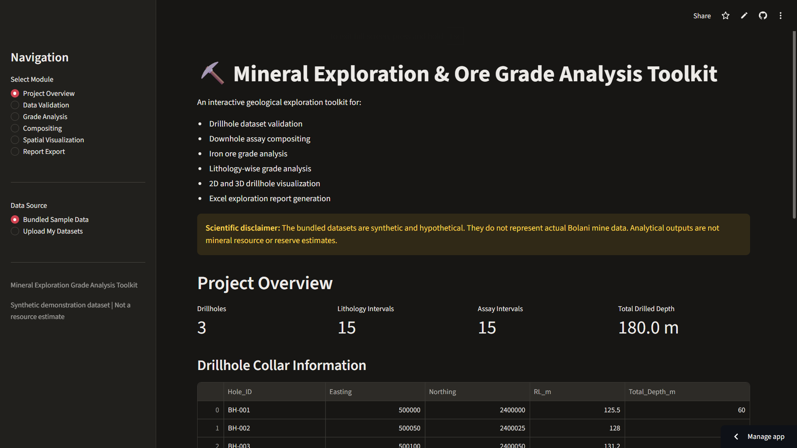

# Mineral Exploration & Ore Grade Analysis Toolkit

An interactive Python-based geological exploration toolkit for drillhole data validation, downhole assay compositing, iron ore grade analysis, drillhole spatial visualization, and Excel exploration reporting.

Built with Python, Streamlit, Pandas, NumPy, Plotly, and OpenPyXL.

## Live Application

**[Launch Mineral Exploration & Ore Grade Analysis](https://mineral-exploration-grade-analysis.streamlit.app/)**



## Project Overview

The toolkit provides a structured workflow for preliminary mineral exploration data analysis using drillhole datasets.

### Key Features

- **Drillhole Data Validation:** Validate collar, survey, lithology, and assay datasets.
- **Downhole Assay Compositing:** Generate fixed-length composites using interval-length-weighted grade calculations.
- **Iron Ore Grade Analysis:** Calculate grade statistics, weighted grades, drillhole summaries, lithology summaries, and grade-thickness values.
- **Cut-off Grade Analysis:** Filter assay intervals using a user-selected Fe grade threshold.
- **2D Spatial Visualization:** Display drillhole collar locations using projected coordinates.
- **3D Drillhole Visualization:** Visualize simplified drillhole trajectories.
- **Excel Report Generation:** Export exploration datasets, composite results, grade summaries, and statistics into a formatted Excel workbook.

## Application Modules

| Module | Description |
|---|---|
| `data_validation.py` | Drillhole dataset validation |
| `compositing.py` | Length-weighted downhole compositing |
| `grade_analysis.py` | Ore grade statistics and analysis |
| `spatial_analysis.py` | 2D collar maps and 3D drillhole traces |
| `reporting.py` | Excel exploration report generation |

## Technology Stack

- Python 3.12
- Streamlit
- Pandas
- NumPy
- Plotly
- SciPy
- Scikit-learn
- OpenPyXL
- Pytest

## Project Structure

```text
Mineral-Exploration-Grade-Analysis/
|
|-- data/
|   |-- sample/
|       |-- collar.csv
|       |-- survey.csv
|       |-- lithology.csv
|       |-- assay.csv
|
|-- docs/
|   |-- images/
|       |-- project-overview.png
|
|-- outputs/
|-- src/
|   |-- __init__.py
|   |-- data_validation.py
|   |-- compositing.py
|   |-- grade_analysis.py
|   |-- spatial_analysis.py
|   |-- reporting.py
|
|-- tests/
|-- .github/
|-- app.py
|-- requirements.txt
|-- README.md
|-- LICENSE
|-- .gitignore
```

## Installation and Setup

### 1. Clone the repository

```bash
git clone https://github.com/helldeepak116-design/Mineral-Exploration-Grade-Analysis.git
cd Mineral-Exploration-Grade-Analysis
```

### 2. Create a virtual environment

```bash
python -m venv .venv
```

### 3. Activate the environment

Windows PowerShell:

```powershell
.venv\Scripts\Activate.ps1
```

### 4. Install dependencies

```bash
python -m pip install --upgrade pip
pip install -r requirements.txt
```

### 5. Run the application

```bash
streamlit run app.py
```

The application will normally open at:

```text
http://localhost:8501
```

## Running Tests

Run the complete automated test suite:

```bash
python -m pytest -v
```

Current verification:

- **141 automated tests passed**
- **0 test failures**

The tests cover data validation, compositing, grade analysis, spatial analysis, and Excel reporting.

## Sample Dataset

The repository includes four sample CSV datasets:

| Dataset | Purpose |
|---|---|
| `collar.csv` | Drillhole identification, collar coordinates, elevation, and total depth |
| `survey.csv` | Downhole survey measurements |
| `lithology.csv` | Lithological interval information |
| `assay.csv` | Downhole assay intervals and chemical grades |

The application also supports uploading datasets for analysis.

## Excel Exploration Report

The report-generation module exports an eight-worksheet Excel workbook:

1. Collar_Data
2. Survey_Data
3. Lithology_Data
4. Assay_Data
5. Composite_Results
6. Drillhole_Grade_Summary
7. Lithology_Grade_Summary
8. Grade_Statistics

The workbook includes formatted headers, frozen header rows, automatic filters, and numerical summaries.

## Scientific Methodology and Limitations

### Downhole Compositing

Composites are generated using interval-length-weighted average grades:

**Composite Grade = Sum(Individual Grade × Interval Length) / Sum(Interval Length)**

Where:

- Individual Grade represents the assay grade.
- Interval Length represents the corresponding assay interval length.

Partial final composites are retained where applicable. No extrapolation is performed beyond sampled intervals.

### Grade-Thickness Analysis

Grade-thickness is calculated as:

**Grade-Thickness = Grade (%) × Interval Thickness (m)**

This is a grade-thickness indicator, not contained metal or tonnage.

### Spatial Visualization

The 2D map displays collar locations using Easting and Northing coordinates.

The current 3D drillhole trace implementation uses the first survey station's orientation as a constant trajectory. It is a simplified visualization and does not represent a fully survey-corrected drillhole path.

### Important Exploration Limitations

- Composite grades are downhole length-weighted, not true-width-weighted.
- Overall grade summaries are interval-length-weighted, not tonnage-weighted.
- No density-based tonnage calculation is implemented.
- No mineral resource or ore reserve estimation is performed.
- The toolkit does not replace geological interpretation, QA/QC procedures, or professional resource estimation workflows.

## Scientific Data Disclaimer

**The bundled datasets are synthetic and hypothetical. They do not represent actual Bolani Ores Mines data or any verified mineral exploration dataset.**

The sample results are intended for software demonstration, testing, and educational purposes only. Analytical outputs must not be interpreted as actual mineral resource or reserve estimates.

## Potential Future Enhancements

- Survey-corrected 3D drillhole trajectories using minimum-curvature calculations.
- Geological cross-section generation.
- Drillhole assay visualization along 3D traces.
- Geostatistical interpolation and exploratory spatial analysis.
- Density integration and preliminary tonnage calculations.
- Enhanced GIS integration and geological mapping.
- Advanced QA/QC and assay quality-control workflows.

## Author

Developed as a geological data analysis and mineral exploration software project.

**Academic Background:** M.Tech Applied Geology, National Institute of Technology Raipur.

**Technical Interests:** Mineral Exploration, Ore Geology, Geological Data Analysis, Remote Sensing and GIS, and Geospatial Modeling.

## License

This project is released under the MIT License. See the `LICENSE` file for details.
